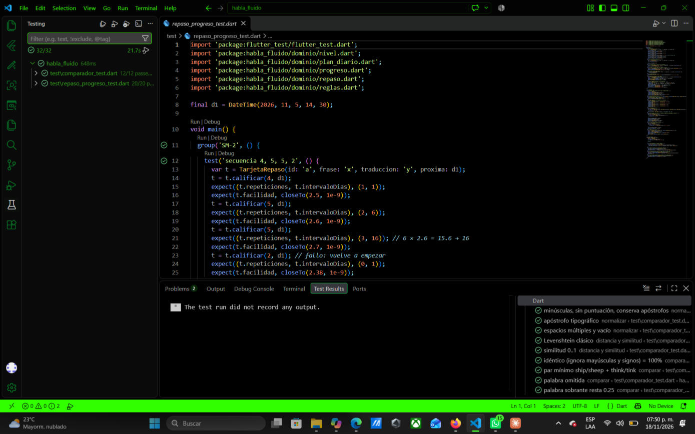

# 🗣️ Habla Fluido — Aprende inglés con un tutor de IA

App en Flutter, hecha con **TDD**, para practicar inglés: pronunciación, oído (dictado), lectura, escritura y conversación con un tutor de IA. Incluye repetición espaciada (SM-2), un plan diario que da más tiempo a la habilidad más débil y un **proxy en Node** para usar la IA sin exponer la llave.

- **Materia:** Desarrollo Móvil Integral · UTNG
- **Profesor:** Anastacio Rodríguez García
- **Alumno:** Adrian Ramirez Mendez · No. de control 1225100309 · Grupo GTID243

---

## 📋 ¿Qué se hizo? (resumen por ronda)

| Ronda | Qué se construyó | Archivo(s) |
|---|---|---|
| 0 | Metodología: input comprensible, output, corregir poco, inteligibilidad, frases completas, repetición espaciada | — |
| 1 | Proyecto, paquetes y "perillas pedagógicas" en un solo archivo | `pubspec.yaml`, `reglas.dart`, `nivel.dart`, `excepciones.dart` |
| 2 | **Comparador** palabra por palabra (alineación tipo `diff` de Git + distancia de Levenshtein) | `comparador.dart` |
| 3 | **Repetición espaciada SM-2** | `repaso.dart` |
| 4 | Progreso con promedio móvil exponencial, subir de nivel y **plan diario** (método del mayor resto) | `progreso.dart`, `plan_diario.dart` |
| 5 | Frases, lecturas y el **contrato del tutor** (la salida de la IA se valida como entrada no confiable) | `frase.dart`, `lectura.dart`, `tutor.dart`, `voz.dart`, `almacen.dart` |
| 6 | **Proxy en Node**: llave y prompt en el servidor, validación, límite por minuto (429) y token (401) | `proxy/` |
| 7 | **Tutor simulado** (sin internet ni costo) y cliente HTTP seguro | `tutor_simulado.dart`, `tutor_http.dart` |
| 8 | Voz: texto a voz y reconocimiento, detrás de un contrato | `voz_real.dart`, `voz_simulada.dart` |
| 9 | **ViewModels** de cada ejercicio | `presentacion/vm/` |
| 10 | Pantallas y raíz de composición | `presentacion/pantallas/`, `dependencias.dart`, `main.dart` |

### Ciclo TDD
🔴 **ROJO:** prueba primero (falla) → 🟢 **VERDE:** código mínimo → 🔵 **REFACTOR:** ordenar sin romper nada.

### Pruebas
- **Flutter:** 78 pruebas (comparador 12 · repaso y progreso 20 · tutor 17 · ViewModels 29).
- **Proxy Node:** 12 pruebas (`cd proxy` y luego `node --test`).

---

## 📸 Evidencias TDD

### Ronda 2 · Comparador
**🔴 Rojo:** la prueba existe pero `comparador.dart` todavía no, así que no compila.


**🟢 Verde:** con `comparador.dart` pasan las 12 pruebas.


### Rondas 3 y 4 · Repetición espaciada, progreso y plan diario
**🔴 Rojo:** faltan `repaso.dart`, `progreso.dart` y `plan_diario.dart`.


**🟢 Verde:** 32/32 en verde.


### Ronda 7 · Tutor
**🔴 Rojo:** faltan `tutor_simulado.dart` y `tutor_http.dart` (0/17).


**🟢 Verde:** 17/17 del tutor, 49/49 en total.


### Ronda 9 · Todo el proyecto
**🟢 78/78 pruebas en verde** con los ViewModels.


---

## ▶️ Cómo ejecutarlo
```bash
flutter create .        # genera android/ ios/ etc. (solo la primera vez)
flutter pub get
flutter test
flutter run
```
Para el proxy:
```bash
cd proxy
node --test
```

## 🔒 Privacidad
- Solo se guarda progreso y tarjetas en el teléfono; la conversación no se guarda.
- La llave de la IA y el prompt viven en el proxy, nunca en la app.
- No escribas datos personales en el chat con el tutor.
