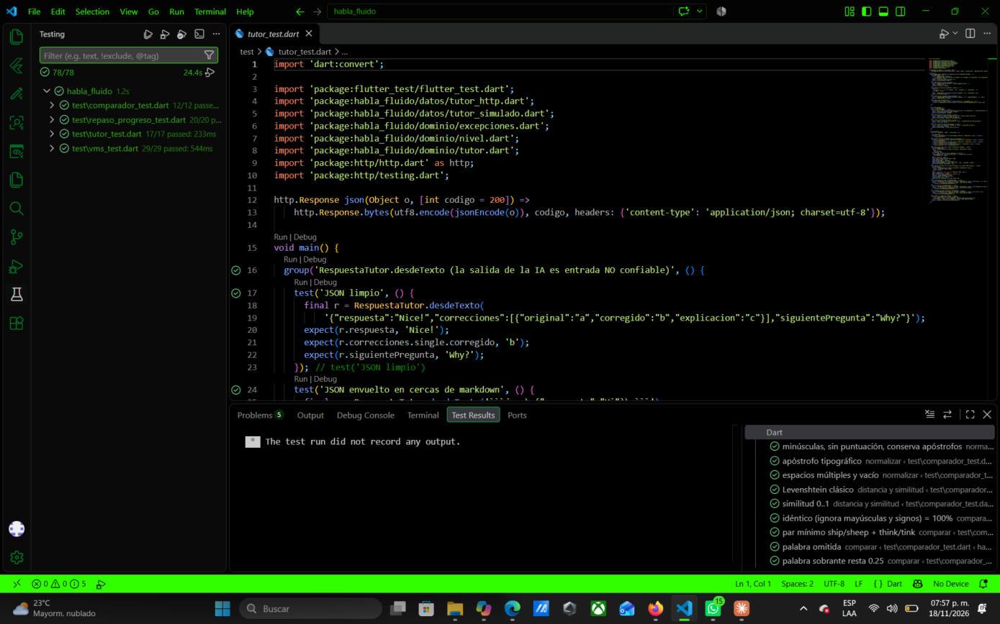

#  Habla Fluido  Aprende inglés con un tutor de IA

R2
### la prueba existe pero `comparador.dart` todavía no, así que no compila.

tes


** Verde:** con `comparador.dart` pasan las 12 pruebas.


--gren aha


** Rojo:** faltan `repaso.dart`, `progreso.dart` y `plan_diario.dart`.


test 


** Verde:** 32/32 en verde.


V

**Rojo:** faltan `tutor_simulado.dart` y `tutor_http.dart` (0/17).


** Verde:** 17/17 del tutor, 49/49 en total.


### ViewModels.


---
Rojo

 verde

 


##  Cómo ejecutarlo
```bash
flutter create .        # genera android/ ios/ etc. (solo la primera vez)
flutter pub get
flutter test
flutter run
```
Para el proxy:
```bash
cd proxy
node --test
```

## 🔒 Privacidad
- Solo se guarda progreso y tarjetas en el teléfono; la conversación no se guarda.
- La llave de la IA y el prompt viven en el proxy, nunca en la app.
- No escribas datos personales en el chat con el tutor.
