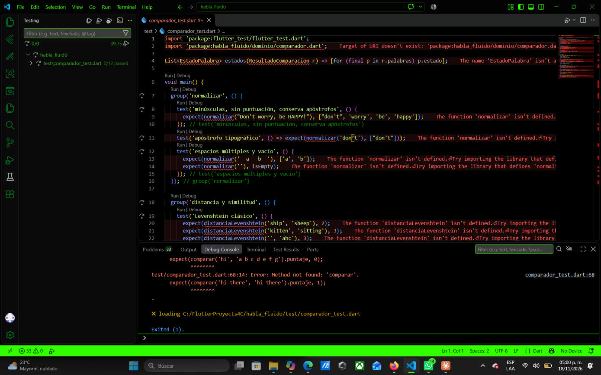
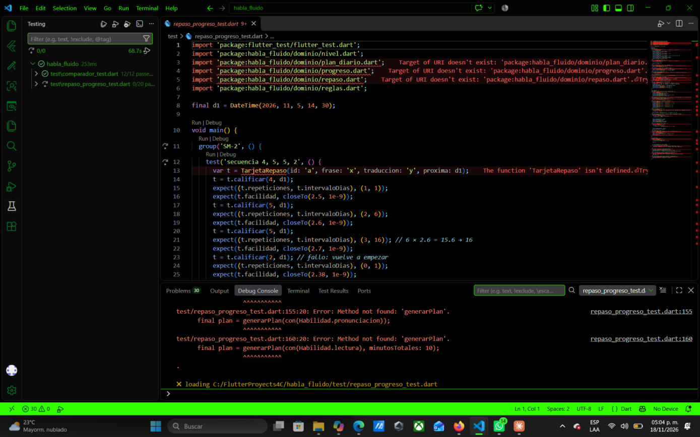
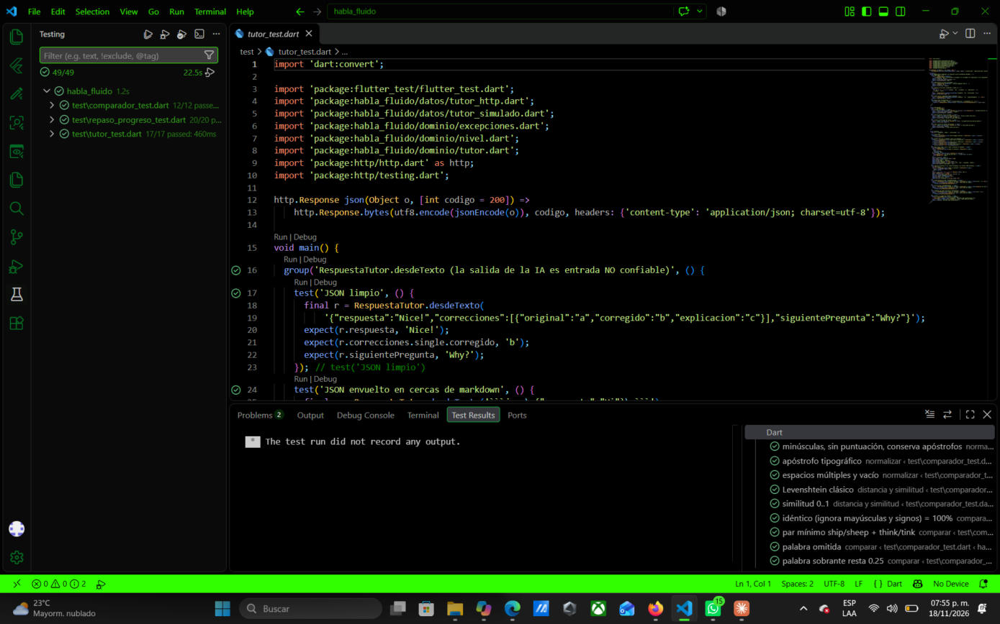

#  Habla Fluido — Aprende inglés con un tutor de IA


### la prueba existe pero `comparador.dart` todavía no, así que no compila.


** Verde:** con `comparador.dart` pasan las 12 pruebas.


** Rojo:** faltan `repaso.dart`, `progreso.dart` y `plan_diario.dart`.


** Verde:** 32/32 en verde.


**Rojo:** faltan `tutor_simulado.dart` y `tutor_http.dart` (0/17).


** Verde:** 17/17 del tutor, 49/49 en total.


### ViewModels.


---

##  Cómo ejecutarlo
```bash
flutter create .        # genera android/ ios/ etc. (solo la primera vez)
flutter pub get
flutter test
flutter run
```
Para el proxy:
```bash
cd proxy
node --test
```

## 🔒 Privacidad
- Solo se guarda progreso y tarjetas en el teléfono; la conversación no se guarda.
- La llave de la IA y el prompt viven en el proxy, nunca en la app.
- No escribas datos personales en el chat con el tutor.
